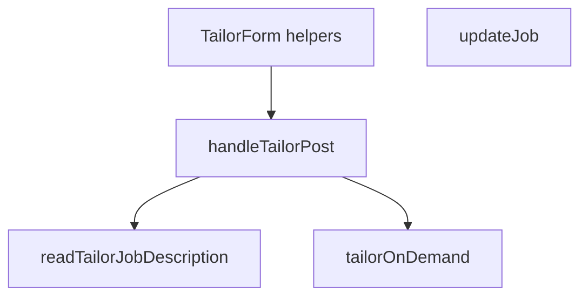
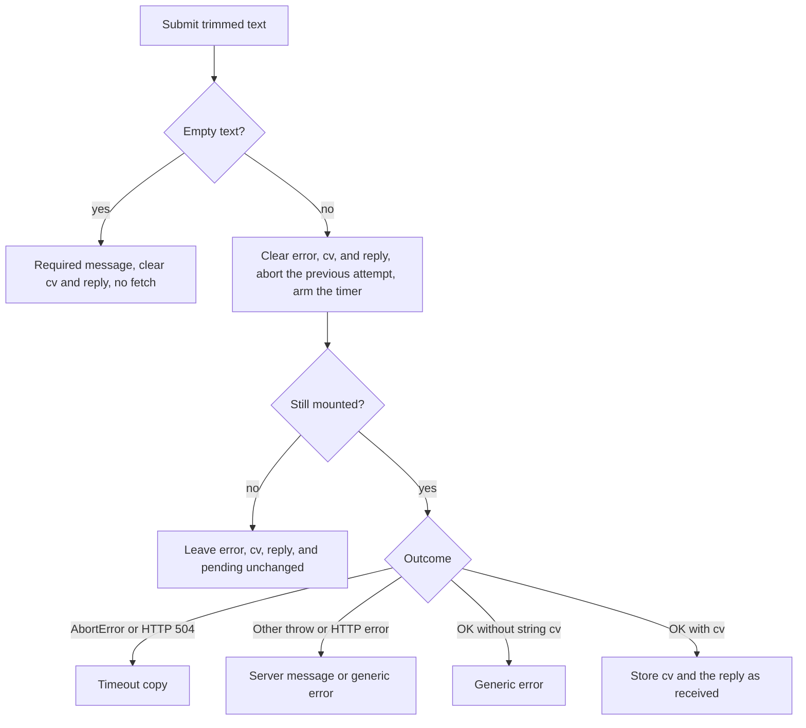

# Tailor Hardening Test Gaps - Plan

## Goal Capsule

- **Objective:** A change that weakens tailor redaction, the sign-in check, upload limits, the upstream deadline, the browser wait, or an in-transaction column move fails the suite, while a signed-in tailor and a column move still behave as they do on the merged hardening branch.
- **Means:** Characterization tests on the merged code, plus a behavior-preserving extraction so the form decisions can be called from `node:test` (KTD1).
- **Authority:** This Product Contract wins on behavior. Key Technical Decisions win on how the tests and the extraction are shaped. The merged tree wins over uncommitted edits on `fix/tailor-proxy-hardening`.
- **Execution profile:** Test-first. U3 writes a failing test, then the smallest extraction that makes `TailorForm` call it.
- **Stop conditions:** Stop if the extraction would change what the operator sees, if a test needs a page renderer, or if the work starts depending on the uncommitted edits on the hardening branch.
- **Ships:** The implementer opens one follow-up pull request. The operator reviews and merges it.

---

## Product Contract

### Summary

After the tailor hardening pull request merges, a follow-up pull request adds tests so each review testing gap fails when that protection is weakened. Operator-visible behavior stays as merged. The form's submit, abort, and leave-page decisions become functions the current suite can call.

### Problem Frame

The hardening review found protections the suite can still miss. An allowlisted error that contains an 8-character window of the API key becomes generic only because of that window check, and the current allowlist tests stay green if the loop is removed. A finished request body still returns 401 if the handler starts reading before the session check. The empty-text gate and the client abort timer still live inside `TailorForm`.

### Key Decisions

- KD1. The follow-up is its own pull request, cut from `main` after the hardening pull request merges. (session-settled: user-approved — chosen over folding these tests into the hardening pull request: that branch is ready to merge, and the operator-visible behavior is already there.) `readTailorResponse` and the submit decisions are private in `app/tailor-form.tsx`. The follow-up stays separate, and KTD1 makes those decisions callable without changing them. Governs the delivery boundary for R1–R18.
- KD2. Submit, abort, and leave-page behavior is covered by functions the current suite calls. (session-settled: user-approved — chosen over mounting `TailorForm`: the suite has no page renderer, and the confirmed scope keeps it that way.) Governs R12–R16.
- KD3. Every testing gap from the hardening review is in this pull request, including the client-deadline inequality and the dev-server bind flag. (session-settled: user-approved — chosen over dropping the small locks: those locks fail when the numbers or the host flag drift.) Governs R11, R17.
- KD4. Residual review notes stay out of this pull request. (session-settled: user-approved — chosen over fixing them here: they are separate product or doc follow-ups, and the empty status patch is pre-existing.) Governs Scope Boundaries.

### Requirements

#### Redaction

- R1. An upstream error is returned only when its trimmed text is an exact allowlisted CCC error and that text contains no 8-character window of the API key. Every other string, including a 7-character key prefix, becomes the generic error.
- R2. A non-string, blank, or whitespace-only upstream `error` becomes the generic client error when it passes through `tailorOnDemand`.

#### Upload and session

- R3. A missing session returns 401 `"Sign in required."` without waiting on a stalled or failed body, and does not call CCC.
- R4. A stream read that fails with an error other than `TimeoutError` returns 400 and `INVALID_JSON`.
- R5. Two chunks that are each under the byte cap and together over it return 413 and `BODY_TOO_LARGE`.
- R6. A request with no body returns an empty job description and does not call `text()`. A body whose `getReader()` is missing applies the byte cap and the read deadline to `text()`.
- R7. `handleTailorPost` returns a body-read 408, a generic stream 400, and a missing-reader oversize 413 without calling CCC.

#### Upstream fetch

- R8. A CCC JSON body that stays open until the fetch abort returns 504 and the generic error.
- R9. A non-OK upstream body that is not JSON keeps the upstream status and the generic error.
- R10. The delay passed to `AbortSignal.timeout` is the rounded timeout, so `40.5` becomes `41`.

#### Client form

- R11. `CLIENT_FETCH_TIMEOUT_MS` stays above the route budget: greater than `maxDuration * 1000`, and greater than `BODY_READ_TIMEOUT_MS + MAX_CCC_FETCH_TIMEOUT_MS`.
- R12. An empty or whitespace-only job description sets `"Job description is required."`, clears cv and reply, and does not fetch.
- R13. A mounted `AbortError` shows the timeout copy, and any other thrown failure shows the generic error.
- R14. After unmount, a later success or failure does not change error, cv, reply, or pending.
- R15. Success without a string `cv` shows the generic error. A reply with non-whitespace is stored as received. A missing or whitespace-only reply is stored as null.
- R16. Starting a tailor clears the previous error, cv, and reply, aborts the previous attempt, and schedules the next abort with `CLIENT_FETCH_TIMEOUT_MS`.

#### Bind and board

- R17. The `dev` script in `package.json` includes `-H 127.0.0.1`.
- R18. When a job's status changes to a third column before the in-transaction read, the saved position comes from that read and the update succeeds.

### Success Criteria

- Each of R1–R18 fails its test when that protection is weakened, and passes on the merged behavior.
- A signed-in tailor still returns a docx and optional reply text. A column move still lands on the position taken inside the transaction.
- `npm test` and `npm run lint` pass with mocked CCC and no page renderer.

### Scope Boundaries

- The API key stays server-side. Tests use a fixture string and assert the generic error. They do not print a real key.
- `CLIENT_FETCH_TIMEOUT_MS` stays the literal `180_000`. The test locks the inequality in R11.
- Leaving the page does not stop the server tailor. This pull request does not add that cancellation.
- A long non-Latin job description that CCC rejects under its own body cap is unchanged.
- `docs/arch/README.md` is unchanged.
- An already-moved card whose status patch is empty is unchanged. Do not add a test whose expected result is `"Job not found"` for that case. The in-memory `updateMany` returns count 1 for empty data, which is a different result from Prisma.
- No page renderer, jsdom, or live `next dev`.
- Companion CCC is out of this repo.

#### Deferred to Follow-Up Work

- A `docs/solutions/` note after this pull request lands. It is not part of the implementation units.

### Acceptance Examples

- AE1. Covers R1. Given API key `xxUnauthorizedyy`, `clientSafeError("Unauthorized", key)` is the generic error: `Unauthor` is an 8-character window of that key, and the full key is not a substring of the message. Given `sk-live-abcdefghijklmnopqrstuvwxyz`, the same message stays `Unauthorized`. A non-allowlisted string is the generic error.
- AE2. Covers R3. Given no session and a body stream that never finishes, when `handleTailorPost` runs, the response is 401 within the existing 400ms race and CCC is not called.
- AE3. Covers R14, R15. Given a successful body `{ cv: "UEsDbA==", replyText: "  Thanks  " }` after unmount, the helper reports that the result is ignored. Given the same body while mounted, the stored reply is `"  Thanks  "`. Given reply `"   "`, the stored reply is null.
- AE4. Covers R18. Given a card the caller still sees as `applied`, when the transaction first observes that card as `offer` and an `interview` card at position 0, an update to `interview` succeeds at position 1.

### Sources

- Review testing gaps, checked against `ff53839` in `app/api/lib/ccc-tailor.ts`, `app/api/lib/read-json-body.ts`, `app/api/lib/tailor-post.ts`, `app/tailor-form.tsx`, `app/lib/tailor-constants.ts`, `lib/jobs.ts`, and `package.json`.
- Existing suite patterns in `tests/ccc-tailor.test.ts`, `tests/tailor-route.test.ts`, `tests/tailor-form.test.ts`, `tests/jobs-isolation.test.ts`, and the source read in `tests/session.test.ts`.
- `nextPosition` in `lib/jobs.ts` is one more than the max position in the destination column.

---

## Planning Contract

### Key Technical Decisions

- KTD1. `readTailorResponse` and `settleTailorAttempt` stay the exported parser and result classifier. Move the empty-text gate and attempt start into functions that `TailorForm` calls. (session-settled: user-approved — chosen over a page renderer: KD2.) The component keeps `fetch("/api/tailor")` and `useState`. Helper names for the remaining two functions are local. A copy of the logic inside the test file does not satisfy R12–R16. The helpers stay free of `TAILOR_API_KEY`. Governs R12–R16.
- KTD2. Stall cases do not wait out `BODY_READ_TIMEOUT_MS`. Where the reader already accepts a deadline, pass about 30ms and race the existing 400ms watchdog. Where the caller has no deadline argument, reject the stream with `TimeoutError`. The handler calls `readTailorJobDescription(request)` with no deadline, so its 408 case uses `TimeoutError`. The no-stream stall stays on the reader. Governs R3, R6, R7, R8.
- KTD3. Spy `AbortSignal.timeout` once, with `timeoutMs: 40.5`, and expect `41`. Restore the spy in `finally`. The call site is `AbortSignal.timeout(resolveCccFetchTimeoutMs(deps))`, so a second spy on `CCC_FETCH_TIMEOUT_MS` is redundant. The existing resolver test keeps `"90000.5"` → `90001`. Governs R10.
- KTD4. The new job case plants a third status so the status patch stays non-empty. Keep the existing test that moves `applied` to `interview` before the read. Do not make that double return count 0. Governs R18.
- KTD5. The timer argument and the dev-server host flag are source assertions. `tests/session.test.ts` is the pattern: read the file and assert the flag or the delay identifier. Do not spawn `next dev`. Governs R16, R17.

### High-Level Technical Design

Each gap locks the function that implements it. The handler tests exist because a reader-only test stays green if `handleTailorPost` stops using that reader.

The form helper reports one outcome. `TailorForm` applies that outcome to state and still arms the abort timer with `CLIENT_FETCH_TIMEOUT_MS`.

### Assumptions

- The starting tree is `fix/tailor-proxy-hardening` at `ff53839`, after the review-feedback commit. That commit added the CCC error allowlist, the null-body skip, and the exported form helpers. The follow-up branch is cut from `main` after that branch merges. Do not revert those commits to match an older test list.
- `SECRET_SUBSTRING_LEN` is 8. `CLIENT_FETCH_TIMEOUT_MS` is `180_000`. `TAILOR_MAX_DURATION_SEC` and route `maxDuration` are 130. `BODY_READ_TIMEOUT_MS` is `30_000`. `MAX_CCC_FETCH_TIMEOUT_MS` is `95_000`.

### Sequencing

U1, U2, and U4 are independent test additions. U3 is the only production edit. Land U3 test-first. Ship all four in the one follow-up pull request from KD1.

---

## Implementation Units

### U1. Lock upstream error and deadline behavior

- **Goal:** `tailorOnDemand` fails the suite when redaction, the rounded abort delay, a stalled JSON body, or a non-JSON error status is weakened.
- **Requirements:** R1, R2, R8, R9, R10
- **Dependencies:** none
- **Files:** `tests/ccc-tailor.test.ts`
- **Approach:** Add cases beside the existing allowlist tests. Keep `"returns only allowlisted CCC errors"` and the bearer case. That bearer string is generic because it is not allowlisted, not because of a wording regex. Do not expect a 7-character key prefix to stay visible.
- **Execution note:** Add the failing assertions against the merged exports. No production edit in this unit.
- **Patterns to follow:** `tests/ccc-tailor.test.ts` restores `process.env` and `globalThis.fetch` in `finally`. Assert `result.ok` and then narrow.
- **Test scenarios:**
  - Happy path: `timeoutMs: 40.5` still returns the docx when `AbortSignal.timeout` is spied and called with `41`.
  - Edge: `clientSafeError("Unauthorized", "xxUnauthorizedyy")` returns the generic error. `clientSafeError("Unauthorized", "sk-live-abcdefghijklmnopqrstuvwxyz")` stays `"Unauthorized"`. A non-allowlisted string, including one that holds only a 7-character key prefix, stays the generic error.
  - Error: `tailorOnDemand` with a non-OK JSON body whose `error` is `null`, `""`, `"   "`, a number, or an object that contains the key returns the generic error and does not include the key.
  - Error: a fetch double returns `new Response("not-json", { status: 500 })`. The result status is 500 and the error is the generic error, not 502 and not the raw text.
  - Integration: a 200 JSON body ignores `init.signal` and never settles. The 400ms watchdog rejects with `"body read stayed open"`. The passing double rejects `json()` with `signal.reason` after an integer `timeoutMs` of about 80. The result is 504 and the generic error.
- **Verification:** The new cases pass. Deleting the interior-window loop, skipping `Math.round` at the `AbortSignal.timeout` call, or mapping a non-OK parse failure to 502 fails the file.

### U2. Lock the upload reader and the tailor entrypoint

- **Goal:** The reader and `handleTailorPost` fail the suite when the session check, the byte cap, or a body-read failure is weakened.
- **Requirements:** R3, R4, R5, R6, R7, R11, R17
- **Dependencies:** none
- **Files:** `tests/tailor-route.test.ts`, `package.json` (read only)
- **Approach:** Extend `readTailorJobDescription` and `handleTailorPost` coverage. Use `streamingJsonRequest` with no `Content-Length` for chunk tests. Keep the existing test that a `body: null` double does not call `text()` and returns an empty job description. The cap and deadline use a body object whose `getReader()` is missing. A real `Request` with a string body still has a stream, so it does not hit that path. Do not assert a pull count. Constructing a `Request` can pull the source. The handler does not take `maxBytes`, so its oversize `text()` must exceed `BODY_MAX_BYTES`.
- **Execution note:** Characterization only. The handler signature stays as merged, with no new deadline argument.
- **Patterns to follow:** The 400ms `"body read stayed open"` race already in `tests/tailor-route.test.ts`. The source read in `tests/session.test.ts`.
- **Test scenarios:**
  - Happy path: the existing budget test stays. Beside it, `CLIENT_FETCH_TIMEOUT_MS > maxDuration * 1000` and `CLIENT_FETCH_TIMEOUT_MS > BODY_READ_TIMEOUT_MS + MAX_CCC_FETCH_TIMEOUT_MS`.
  - Edge: two ASCII chunks of 10 bytes with `maxBytes` 16 return 413 and `BODY_TOO_LARGE`. A per-chunk check would return 400 after concatenation.
  - Edge: a missing `getReader()` whose `text()` exceeds `maxBytes` returns 413. The same shape whose `text()` never settles, with a 30ms deadline, loses the 400ms race and returns 408 and `BODY_READ_TIMEOUT`. `body: null` still does not call `text()`.
  - Error: `controller.error(new Error("boom"))` on the reader returns 400 and `INVALID_JSON`, not 408.
  - Integration: `getSessionUserId` returns null. A stalled stream returns 401 inside the 400ms race and the tailor dep is not called. A stream that errors with a plain `Error` stays 401, not 400.
  - Integration: a signed-in handler whose stream errors with `TimeoutError` returns 408 and `BODY_READ_TIMEOUT` and does not call tailor. A plain stream error returns 400 and `INVALID_JSON` and does not call tailor. A missing-reader body whose `text()` exceeds `BODY_MAX_BYTES` returns 413 and does not call tailor.
  - Edge: `readFileSync` of `package.json` finds `-H 127.0.0.1` on the `dev` script. Dropping `-H` or binding another host fails. The suite does not start the server.
- **Verification:** The new cases pass. Moving the body read above the session check, capping per chunk, or dropping `-H 127.0.0.1` fails the file.

### U3. Make form decisions callable and lock them

- **Goal:** The suite calls the submit and abort decisions that still live only inside `TailorForm`, and the exported parser and classifier stay as they are.
- **Requirements:** R12, R13, R14, R15, R16
- **Dependencies:** none
- **Files:** `app/tailor-form.tsx`, `tests/tailor-form.test.ts`
- **Approach:**
  1. Keep `readTailorResponse` and `settleTailorAttempt`. Extend their tests where a case is still missing.
  2. Move the empty-text gate and the attempt start into functions the component calls. The empty gate returns the required message and clears cv and reply without fetching. Attempt start aborts the previous controller, clears the previous error, cv, and reply, and schedules the next abort with the delay the caller passes.
  3. `TailorForm` calls those functions and still performs `fetch` and `setState`.
  4. Read `app/tailor-form.tsx` and require the `setTimeout` abort to pass `CLIENT_FETCH_TIMEOUT_MS`. Also require the unmount cleanup to abort the current controller.
- **Execution note:** Start with a failing test. Then make the smallest extraction that preserves the outcomes in the form diagram.
- **Patterns to follow:** `tailorFailureMessage` in `tests/tailor-form.test.ts`. Injected deps, as `handleTailorPost` does. `readFileSync` as in `tests/session.test.ts`.
- **Test scenarios:**
  - Happy path: mounted OK `{ cv: "UEsDbA==", replyText: "  Thanks  " }` stores that cv and the reply `"  Thanks  "`.
  - Edge: whitespace-only text returns `"Job description is required."`, clears cv and reply, and does not fetch. Reply `"   "` or a missing reply stores null. `cv` of `""` shows the generic error. A new attempt clears a previous error, cv, and reply before fetch.
  - Edge: malformed JSON becomes an empty result. A non-object JSON value becomes an empty result. A numeric `cv` is dropped. `TimeoutError` from `json()` becomes an empty result. `AbortError` from `json()` is rethrown.
  - Error: mounted `AbortError` shows the timeout copy. A mounted generic throw shows the generic error. Mounted HTTP 504 shows the timeout copy. Mounted HTTP 500 with `error: "Upstream failed"` shows that string.
  - Integration: the same success body after unmount is ignored, including pending. `clearTimeout` still runs. Attempt start aborts the controller it was given and schedules the next abort with the delay it was given. The source of `app/tailor-form.tsx` passes `CLIENT_FETCH_TIMEOUT_MS` into that schedule and aborts on unmount.
- **Verification:** The form tests pass. `TailorForm` calls the helpers. The operator-visible messages and the 180s timer argument are unchanged.

### U4. Lock the in-transaction column position

- **Goal:** A status change that lands before the in-transaction read still takes its position from the row seen in that read.
- **Requirements:** R18
- **Dependencies:** none
- **Files:** `tests/jobs-isolation.test.ts`
- **Approach:** Reuse `createMemoryStore`, `seedJob`, and the `$transaction` wrapper. Plant the third status on the same rows the transaction aggregate reads. `nextPosition` is max position plus one, so an `interview` card at position 0 yields position 1.
- **Execution note:** Characterization only. Do not change `updateJob`.
- **Patterns to follow:** `"allocates a column position from the row seen inside the update transaction"` in `tests/jobs-isolation.test.ts`.
- **Test scenarios:**
  - Happy path: seed `a1` as `applied` at position 0. Before `run()`, set `a1` to `offer` and insert an `interview` card at position 0 that was not present at the call. `updateJob` to `interview` returns `ok: true`, status `interview`, position 1.
  - Edge: the result status is not `offer` and the position is not 0.
  - Error: the existing applied-to-interview mutation test stays as it is. This unit does not expect `not_found` for an empty status patch.
- **Verification:** The new case passes. Taking the position from the caller's earlier column, or keeping status `offer`, fails the test.

---

## Verification Contract

| Check | Command or evidence | Applies |
| --- | --- | --- |
| Unit tests | `npm test` | U1–U4 |
| Lint | `npm run lint` | U1–U4 |
| Live CCC or live model | Unused. Fetch, session, and the job store stay injected. | U1–U4 |
| Browser or page renderer | Unused. U3 calls helpers and reads `app/tailor-form.tsx`. | U3 |
| Behavior unchanged | Messages, status codes, timer literal, and `updateJob` results match the merged branch. | U3, U4 |

---

## Definition of Done

- R1–R18 each have a failing test when the protection is weakened, and the suite is green on the merged behavior.
- U3 is the only production diff, and `TailorForm` calls the extracted functions.
- `npm test` and `npm run lint` pass.
- Abandoned experiments and copied parsers are not in the diff.
- The follow-up does not revert the allowlist, the null-body skip, or the exported form helpers.
- The Active milestone in `docs/plans/README.md` stays M2.
