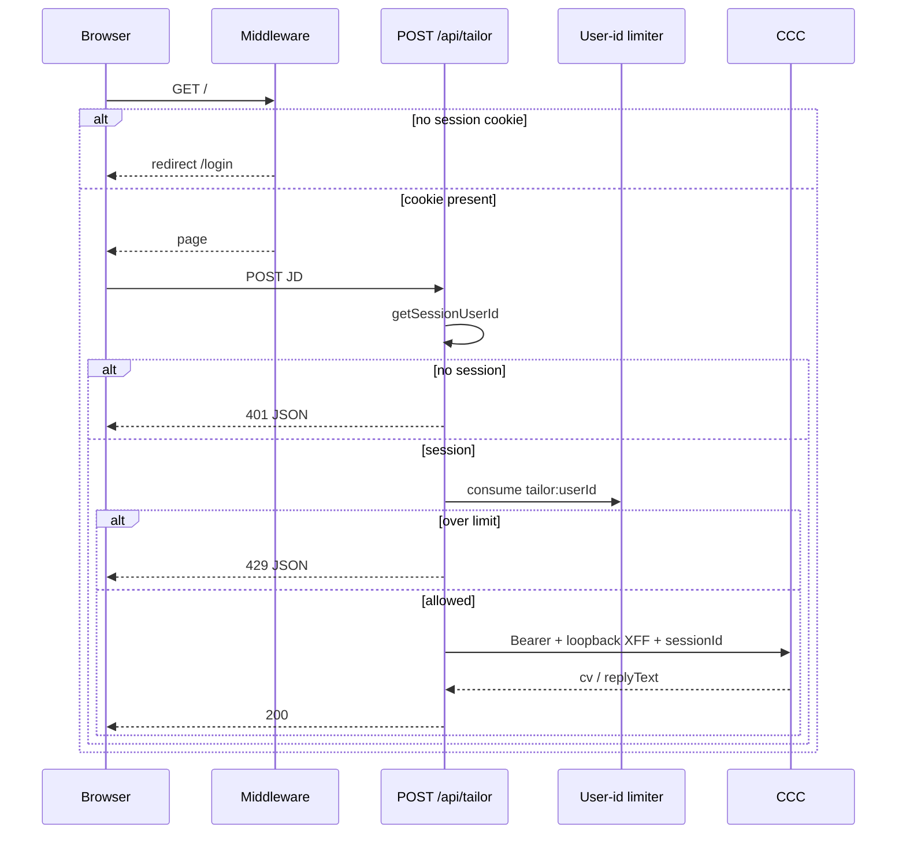

# User ID Rate Limit - Plan

## Goal Capsule

- **Objective:** Every operator who uses this app is signed in, and expensive work is capped per account the same way on any host.
- **Means:** Session-keyed rate limit in this BFF, with a non-spoofable pre-auth fallback and a server-set user identifier on the CCC call (KTD1, KTD2, KTD4).
- **Product authority:** This Product Contract. Companion CCC owns curator/inbox and its own Upstash buckets. Do not merge or close PR #13.
- **Open blockers:** None.
- **Tail:** Do not implement CCC repo changes, Redis, Vercel IP forwarding, or PR #13’s `client-ip.ts`.
- **Execution:** `ce-work` implements; this run opens a PR and does not merge.

---

## Product Contract

### Summary

Authenticated mutating work in this app is limited by the Better Auth session user id, not by client IP.
Unsigned visitors cannot reach the tailor, the board, or `POST /api/tailor`.
Sign-in and sign-up keep a coarse fallback limit that ignores client forwarding headers.
This BFF may tell CCC which user made the call, but only from the session, next to the existing Bearer key.

### Problem Frame

PR #13 forwards Vercel client IPs so CCC’s per-IP bucket can distinguish callers.
That undoes main’s loopback-only `x-forwarded-for`, and anyone can fake IP headers when the app is not on Vercel.
The operator rejected IP-based limits and wants every user signed in and limited by user id, which is the same on Vercel Hobby or a later Railway deploy.

### Key Decisions

- **Rate-limit authenticated work by Better Auth session user id.** `(session-settled: user-directed — chosen over PR #13 Vercel / client-IP forwarding: IP headers are spoofable off Vercel and are not host-portable)` Governs R3, R4, R5.
- **Require sign-in for app routes and API routes that do real work.** `(session-settled: user-directed — chosen over anonymous tailor spend of the shared Bearer: the owner wants every user signed in)` Governs R1, R2.
- **Do not change the CCC repository in this work.** `(session-settled: user-directed — chosen over implementing the companion limiter here: this repo is the BFF; describe any CCC follow-up in the plan and PR)` Governs R7.

### Actors

- A1. Operator — signs in, tailors, manages job cards.
- A2. This app’s server — session, BFF rate limit, Bearer presenter.
- A3. CCC tailor API — unchanged dual buckets until a companion change; still requires an IP header.

### Requirements

**Sign-in gate**

- R1. Unauthenticated visits to `/` and `/board` redirect to `/login` and do not load tailor or job data.
- R2. Unauthenticated `POST /api/tailor` returns 401 JSON with a client-safe `error` and does not consume a rate-limit token or call CCC.

**Session-keyed limits**

- R3. After a valid session, tailor POST and job mutations consume a per-user bucket before upstream or database work. Over limit: tailor returns 429 JSON; job Server Actions return `{ error }` without persisting.
- R4. Two different session user ids do not share a bucket.
- R5. A spoofed inbound `X-Forwarded-For` does not change the user bucket, does not change CCC’s `x-forwarded-for` (still loopback), and is not copied to CCC.

**Pre-auth fallback**

- R6. Sign-in and sign-up keep a fallback limit that does not read client-supplied forwarding headers. Distinct users on those paths may share one per-path counter.

**CCC presentation**

- R7. The BFF sends CCC the existing Bearer key plus a server-set `sessionId` equal to the session user id. It never copies inbound client headers or inbound body identity fields (`sessionId` in the client JSON is ignored). Loopback `x-forwarded-for` stays so CCC does not 400 on missing IP.
- R8. `TAILOR_API_KEY`, `CCC_API_URL`, and auth secrets stay server-only.

### Key Flows

- F1. Signed-in tailor
  - **Trigger:** Operator submits a JD on `/`.
  - **Steps:** Session check, user-id consume, then `tailorOnDemand` with Bearer, loopback IP, and `sessionId`.
  - **Covered by:** R3, R4, R7.
- F2. Anonymous tailor
  - **Trigger:** `POST /api/tailor` with no session.
  - **Steps:** 401 JSON. No consume. No CCC fetch.
  - **Covered by:** R2.
- F3. Pre-auth
  - **Trigger:** Sign-in or sign-up POST to `/api/auth/*`.
  - **Steps:** Better Auth limiter with empty IP header list. Spoofed `X-Forwarded-For` does not mint a fresh bucket.
  - **Covered by:** R6.

### Acceptance Examples

- AE1. Per-user tailor limit
  - **Covers R3, R4.**
  - **Given:** User A is at the tailor ceiling.
  - **When:** A posts another JD and user B posts a JD.
  - **Then:** A gets 429 and no CCC call. B is allowed.
- AE2. Anonymous short-circuit
  - **Covers R2.**
  - **Given:** No session.
  - **When:** Client POSTs `/api/tailor` with a JD and a spoofed `X-Forwarded-For`.
  - **Then:** 401. Limiter not called. CCC not called.
- AE3. Spoofed forwarding header
  - **Covers R5, R7.**
  - **Given:** User A is signed in.
  - **When:** The request sets `X-Forwarded-For` to a public IP.
  - **Then:** The user bucket is still A. CCC `x-forwarded-for` is `127.0.0.1`. CCC body `sessionId` is A’s user id even if the client JSON also sent `sessionId: "other-user"`.

### Success Criteria

- `npx tsc --noEmit`, `npm run lint`, and `npm test` pass.
- Tests prove AE1–AE3 and that unauthenticated protected pages redirect.

### Scope Boundaries

**Deferred for later**

- Durable Postgres (or Redis) counters across serverless isolates.
- Email-keyed pre-auth limits beyond Better Auth’s shared per-path counter.
- Rate-limiting RSC GET page loads.

**Deferred to Follow-Up Work**

- Companion CCC: key its current IP bucket on Bearer-authenticated `sessionId` when present; keep rightmost XFF for callers that omit `sessionId`; never read a user id from client headers; keep the shared-secret bucket as the global cap. Precise change is in Documentation / Operational Notes.
- PR #13 remains open. Do not merge or close it. Do not land `app/api/lib/client-ip.ts` or `CCC_TRUSTED_PROXY`.

**Outside this product's identity**

- Rebuilding Gmail / inbox scan in this repo.
- Putting `TAILOR_API_KEY` in the browser.
- Trusting `X-Forwarded-For` or `x-vercel-forwarded-for` as a rate-limit key.

---

## Planning Contract

### Key Technical Decisions

- KTD1. **App limiter is a small injectable sliding-window helper keyed only by a caller-supplied id.** Files: `lib/rate-limit.ts`, `tests/rate-limit.test.ts`. Default store is an in-memory map so `npm test` stays Postgres-free (same convention as jobs tests). Prefix keys (`tailor:` vs `jobs:`) so board clicks do not starve tailor. Caps from env documented in `.env.example`: tailor `RATE_LIMIT_MAX=5` / `RATE_LIMIT_WINDOW=60000` (match CCC); jobs `JOB_RATE_LIMIT_MAX=30` / same window so column moves stay usable. In-memory is isolate-local on Vercel; CCC’s shared-secret bucket remains the global backstop for tailor only. Postgres `rateLimit` storage did not qualify for a bake-off: reversal is adding a store later, not a data-shape fork. `(session-settled: user-directed — chosen over IP buckets: host-portable user id)` Instantiates R3, R4.
- KTD2. **Order is session → fail closed → validate input → consume → work.** `handleTailorPost` already 401s before CCC; keep that first. Parse JSON next: invalid JSON or empty/oversize JD returns 400 without consume. Then consume `tailor:<userId>` before `tailorOnDemand`. Job Server Actions consume after `requireSessionUserId` and before the DAL. Null session must not increment any counter. Tailor 429 uses a client-safe `error` and optional `Retry-After`. Server Actions have no HTTP 429: return `{ error }` like other action failures. Instantiates R2, R3.
- KTD3. **Cookie middleware covers HTML pages only.** Expand `middleware.ts` matcher to `/` and `/board` (and board subpaths). Do not match `/api/tailor`: a redirect would turn `TailorForm`’s JSON 401 into an HTML 307. `/login`, `/register`, and `/api/auth/*` stay public. Instantiates R1.
- KTD4. **CCC call keeps loopback XFF and adds body `sessionId` from the session user id.** Do not copy inbound headers. CCC today ignores `sessionId` for limits and 400s when IP is missing, so loopback stays required. Instantiates R5, R7.
- KTD5. **Pre-auth uses Better Auth’s limiter with empty `ipAddressHeaders`.** Official “clients connect directly” mode: one shared counter per path, no `X-Forwarded-For`. Do not set `disableIpTracking: true` (that turns HTTP limiting off). `keyGenerator` does not exist in Better Auth 1.7.3. Keep production-default `enabled`. Override Better Auth’s built-in `/sign-in*` and `/sign-up*` special rule (3 per 10s) with `customRules` `{ window: 10, max: 100 }` for `/sign-in/email` and `/sign-up/email` so the shared counter stays coarse (R6). Instantiates R6.
- KTD6. **Bring PR #13’s `wrapJob` / `jobsStoreFromPrisma` typing only.** Replace `getPrisma() as unknown as JobsStore` (GitHub issue #2). Narrow `orderBy` to `status` | `position`. Do not take IP forwarding files or KTD6 rewrites from that PR.

### Assumptions

- In-memory counters are enough for a small operator app on Vercel Hobby; isolate reset is accepted.
- Job mutations are in scope for the user-id limiter with a separate, looser cap.
- Page GETs stay session-gated and are not windowed.
- Better Auth rate-limit storage stays memory (no new Prisma `rateLimit` table in this PR).
- Forwarding `sessionId` now is contract-compatible even while CCC ignores it.

### High-Level Technical Design

Middleware never sees `/api/tailor`. Job Server Actions follow the same session → consume → DAL order inside `mutateBoard`.

### System-Wide Impact

- **Middleware:** cookie redirect on `/` and `/board` only. `/api/tailor` stays a JSON 401 from the route. `/api/auth/*` stays public.
- **TailorForm:** already displays `body.error` for non-OK JSON, including 429.
- **Kanban actions:** `{ error }` on limit, same as DAL failures; no HTTP status.
- **CCC:** still sees loopback IP and a shared secret. The companion `sessionId` change only splits the IP bucket; the hashed-secret ceiling (default `floor(RATE_LIMIT_MAX / 2)`) stays a global cap. This BFF’s per-user 429 is the discriminator this repo owns.
- **PR #13:** leftover IP forwarding must not land. wrapJob may.

### Risks & Dependencies

- Isolate-local memory under-enforces the same user across Vercel instances. Mitigation: CCC shared-secret bucket backstops tailor spend only; job mutations and pre-auth have no equivalent global cap until a durable store exists.
- Shared pre-auth path counter can 429 the only operator if a noisy client hammers `/sign-in/email`. Mitigation: first-operator lock only closes public sign-up, not sign-in. Empty `ipAddressHeaders` plus coarse `customRules` (KTD5) is chosen because it is safer than spoofable XFF, not because lockout is eliminated.
- CCC 429 can still fire while the BFF bucket has remaining tokens. Mitigation: TailorForm shows CCC’s client-safe error; do not remap 429 to 502.
- Consume-before-CCC (KTD2) means repeated CCC 5xx/429 can exhaust the per-user BFF tailor ceiling without a successful CV. Accepted: empty/invalid JD does not consume; retries of a true upstream failure do.
- wrapJob types depend on generated Prisma `job` delegate. Mitigation: existing `postinstall` / `build` `prisma generate`.

### Sequencing

U1 helper + tests → U2 tailor path → U3 job actions → U4 Better Auth pre-auth → U5 middleware + wrapJob → U6 env/docs.

### Sources / Research

- `app/api/lib/tailor-post.ts`, `app/api/lib/ccc-tailor.ts`, `middleware.ts`, `lib/session.ts`, `lib/jobs.ts`, `tests/ccc-tailor.test.ts`
- CCC `app/api/lib/rate-limit.ts`: dual IP + secret-hash buckets; `_sessionId` reserved and unused; missing IP → 400; rightmost XFF
- Better Auth 1.7.3 rate-limit docs: default XFF; `ipAddressHeaders: []` shares one counter per path; no `keyGenerator`
- PR #13: reject `client-ip.ts`; keep `wrapJob`
- Kanban plan leaves per-user tailor rate limits out of M2; this plan owns that BFF ceiling

---

## Implementation Units

### U1. Session-keyed limiter helper

- **Goal:** Injectable sliding-window consume/allow API keyed only by the id the caller passes.
- **Requirements:** R3, R4.
- **Files:** `lib/rate-limit.ts`, `tests/rate-limit.test.ts`, `.env.example`
- **Approach:** Named export, discriminated `{ ok: true } | { ok: false, retryAfterSeconds }`. Inject the store in tests. Read max/window from env with the defaults in KTD1. Do not read request headers inside this module.
- **Execution note:** Implement new domain behavior test-first.
- **Patterns to follow:** `lib/jobs.ts` injected `deps`; `tests/ccc-tailor.test.ts` node:test style.
- **Test scenarios:**
  - Same key over the max in one window is denied; a different key is allowed.
  - After the window, the same key is allowed again.
  - Missing/blank key is invalid and does not consume.
- **Dependencies:** none.
- **Verification:** Isolated tests pass without Prisma or Better Auth.

### U2. Tailor POST: 401 then user-id limit then CCC

- **Goal:** Anonymous tailor never spends a token or the Bearer. Signed-in tailor is limited per user and presents `sessionId`.
- **Requirements:** R2, R3, R4, R5, R7, R8.
- **Files:** `app/api/lib/tailor-post.ts`, `app/api/lib/ccc-tailor.ts`, `tests/ccc-tailor.test.ts` (or split `tests/tailor-post.test.ts` if the file grows)
- **Approach:** After the existing null-session 401, parse the body (KTD2) and ignore any client `sessionId`. Then consume `tailor:<userId>`. Denied → 429, no `tailorOnDemand`. Allowed → pass `sessionId: userId` from the session only into the CCC JSON body. Keep `clientIp` as `TRUSTED_CCC_CLIENT_IP`. Inject the limiter in tests.
- **Execution note:** Implement new domain behavior test-first. See red for AE1–AE3 before green.
- **Patterns to follow:** Existing `handleTailorPost` session short-circuit and CCC 401→502 mapping.
- **Test scenarios:**
  - Covers AE2. No session → 401, limiter not called, tailor not called, even with spoofed XFF.
  - Covers AE1. User A exhausted → 429 and no CCC; user B still 200.
  - Covers AE3. Spoofed XFF and a client JSON `sessionId` of another user do not change the bucket or CCC `x-forwarded-for`; CCC body `sessionId` is the session user id.
  - Invalid JSON, empty JD, or oversize JD after a valid session returns 400 without consume or CCC.
- **Dependencies:** U1.
- **Verification:** Tailor tests cover AE1–AE3; existing 200/502/empty-JD cases still pass.

### U3. Job mutations consume after session

- **Goal:** Signed-in board writes share a per-user jobs bucket; unsigned actions still redirect with no consume.
- **Requirements:** R1, R3, R4.
- **Files:** `app/actions/jobs.ts`, `tests/jobs-isolation.test.ts` or `tests/jobs-actions.test.ts`
- **Approach:** In `mutateBoard`, after `requireSessionUserId`, consume `jobs:<userId>` with the looser cap. Denied → `{ error }` and no DAL. Redirect on missing session must happen before consume (`requireSessionUserId` already redirects).
- **Execution note:** Implement new domain behavior test-first.
- **Patterns to follow:** Current `mutateBoard` try/catch and `{ error }` envelope.
- **Test scenarios:**
  - Exhausted jobs bucket → error, store unchanged.
  - Second user id is not blocked by the first user’s jobs bucket.
  - Missing session never reaches consume (mock `requireSessionUserId` / inject limiter).
- **Dependencies:** U1.
- **Verification:** Isolation tests still pass; new consume tests green.

### U4. Pre-auth fallback without forwarding headers

- **Goal:** Sign-in/sign-up cannot be bucket-rotated via `X-Forwarded-For`.
- **Requirements:** R6.
- **Files:** `lib/auth.ts`, `tests/session.test.ts` (or `tests/auth-rate-limit.test.ts`)
- **Approach:** Set `advanced.ipAddress.ipAddressHeaders` to an empty list. Do not add `x-forwarded-for` or Vercel headers. Do not enable `disableIpTracking`. Leave `rateLimit.enabled` on its production default unless a test needs it forced on via env in that test only. Set `customRules` for `/sign-in/email` and `/sign-up/email` to `{ window: 10, max: 100 }` (KTD5).
- **Patterns to follow:** `tests/session.test.ts` source-read of `app/login/page.tsx` for secret leakage.
- **Test scenarios:**
  - `lib/auth.ts` source includes empty `ipAddressHeaders` and does not list `x-forwarded-for` or `x-vercel-forwarded-for`.
  - Config does not set `disableIpTracking: true`.
  - `customRules` for `/sign-in/email` and `/sign-up/email` set window 10 and max 100.
- **Dependencies:** none.
- **Verification:** Source-level tests pass; typecheck still accepts `lib/auth.ts`.

### U5. Page middleware and wrapJob typing

- **Goal:** Unsigned visitors never render `/`; Prisma job access is typed without `unknown`.
- **Requirements:** R1.
- **Files:** `middleware.ts`, `tests/session.test.ts`, `lib/jobs.ts`, `tests/jobs-isolation.test.ts`, `tests/schema.test.ts` only if the wrapJob orderBy narrowing requires it
- **Approach:** Matcher includes `/` and `/board` paths, not `/api/*`. Keep `getSessionCookie` only. Add `wrapJob` / `jobsStoreFromPrisma` from PR #13 and the matching `orderBy` field guard in the memory store test helper.
- **Patterns to follow:** Current middleware cookie redirect; PR #13 `lib/jobs.ts` wrapJob (IP files excluded).
- **Test scenarios:**
  - Middleware source matcher includes `/` and `/board` and does not include `/api/tailor`.
  - Existing jobs isolation tests still pass through the typed store.
- **Dependencies:** none (can parallel U1).
- **Verification:** Jobs tests green; middleware source assertion green.

### U6. Env catalog and contract notes

- **Goal:** Operators and agents see the BFF caps and the CCC follow-up without treating the companion change as shipped.
- **Requirements:** R7, R8.
- **Files:** `.env.example`, `README.md`, `docs/arch/README.md`, `docs/api/API.md` (mirror note only: this BFF sends `sessionId`; CCC still does not key on it)
- **Approach:** Document BFF `RATE_LIMIT_MAX`, `RATE_LIMIT_WINDOW`, and `JOB_RATE_LIMIT_MAX` with the KTD1 defaults. Do not claim CCC per-user spend caps. Do not add `NEXT_PUBLIC_` secrets.
- **Test expectation:** none -- docs and env catalog only; secret-absence already covered by R8 tests elsewhere.
- **Dependencies:** U1, U2.
- **Verification:** `.env.example` lists every new env var with a comment.

---

## Verification Contract

| Gate | Command | Proves |
|------|---------|--------|
| Unit tests | `npm test` | AE1–AE3, jobs isolation, auth config, wrapJob |
| Types | `npx tsc --noEmit` | wrapJob typing, limiter types |
| Lint | `npm run lint` | repo bar |
| Build | `npm run build` | App Router compile |

No live LLM. No live CCC. No live Postgres required for `npm test`.

---

## Definition of Done

- All units above are implemented on a feature branch, not `main`.
- AE1–AE3 have been seen red then green.
- Typecheck, lint, and `npm test` pass.
- PR opened against `main` describing the design and the CCC follow-up. PR #13 is not merged or closed.
- Abandoned spike files (`client-ip.ts` from #13, unused IP helpers) are absent from the diff.

### Documentation / Operational Notes

Companion CCC change (not this PR), for `https://github.com/mikkel250/ccc`:

1. In `checkRateLimit`, when Bearer auth succeeded and body `sessionId` is a non-empty string, use that string as the current IP-bucket Redis key instead of `parseClientIp`.
2. When `sessionId` is missing, keep today’s rightmost `x-forwarded-for` key (smoke CLI and other non-BFF callers).
3. Still 400 when that fallback IP is unknown.
4. Do not read user identity from inbound headers.
5. Keep the hashed shared-secret bucket as the global cap (at documented defaults `floor(RATE_LIMIT_MAX / 2)`). Keying the IP bucket on `sessionId` does not create per-user CCC spend caps unless `RATE_LIMIT_SECRET_MAX` is raised separately.
6. Tests: two `sessionId` values with the same XFF do not share the user-named bucket; a spoofed XFF does not change a `sessionId` bucket; omitted `sessionId` still uses rightmost XFF.
